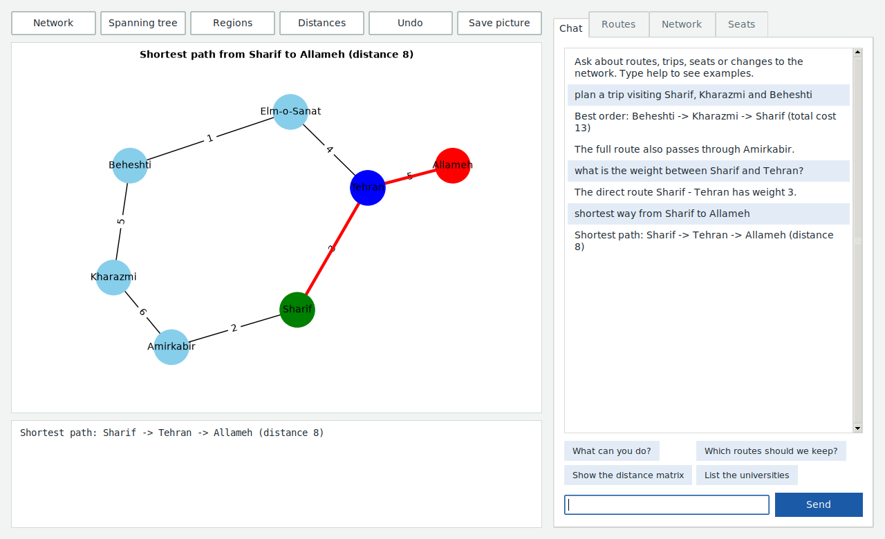
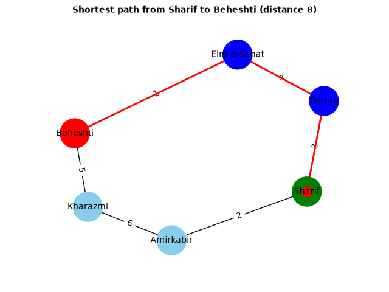
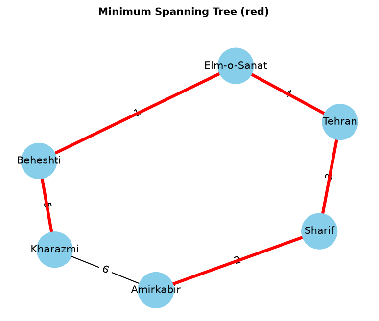
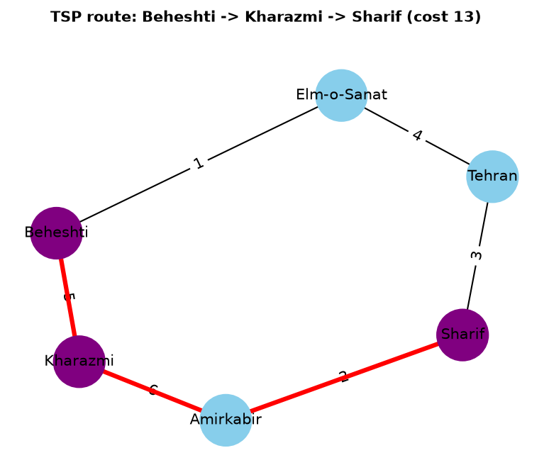
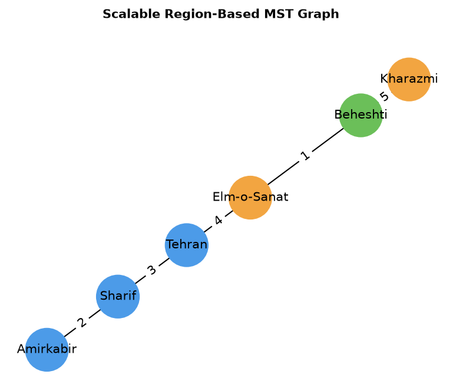
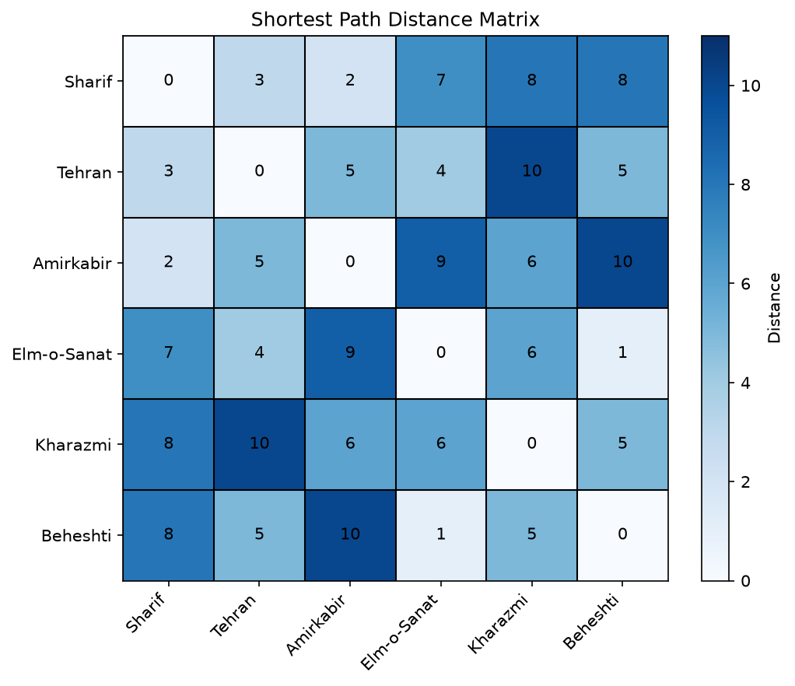
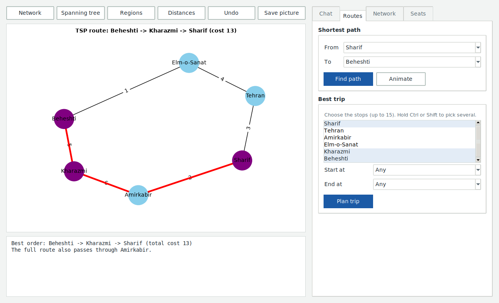
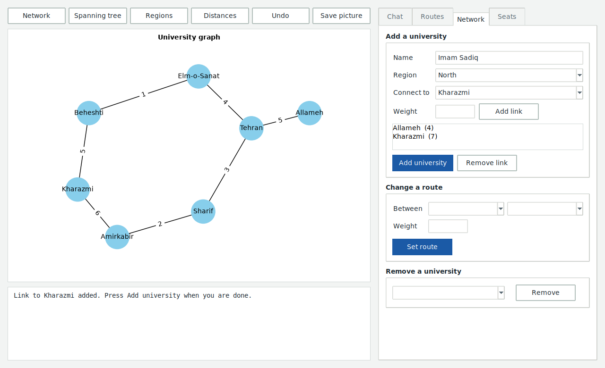
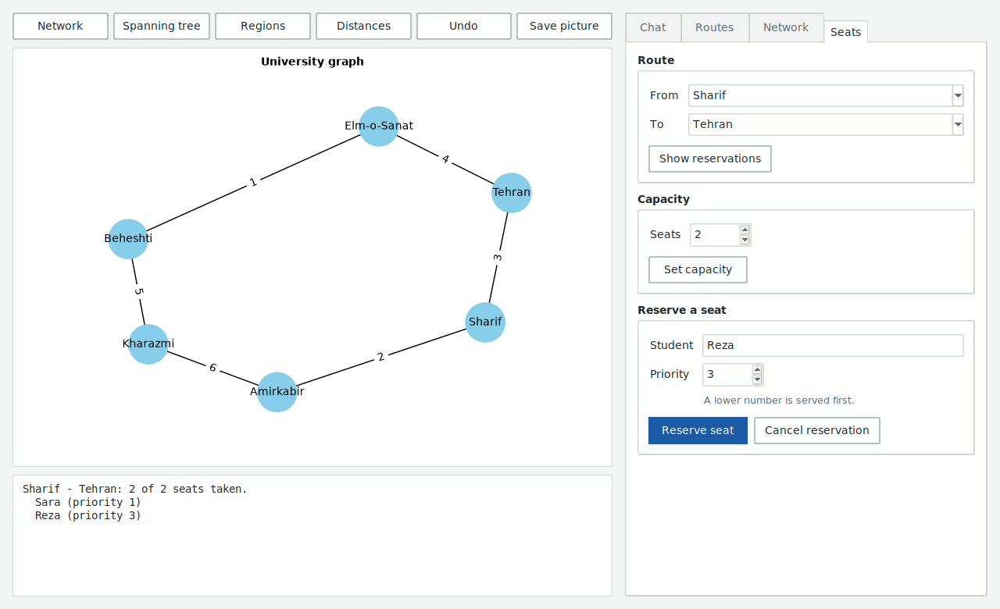

# Campus Route Planner

A desktop app for planning transport between universities. Universities are nodes in
a weighted graph and bus routes are edges. It was built for an algorithm design course
project and covers all four phases of the brief.

<p align="center">
  
</p>

## Features

| Phase | Feature | Algorithm |
|-------|---------|-----------|
| 1 | Minimum spanning tree of the route network | Prim with a priority queue |
| 1 | Add a university and connect it without rebuilding the graph | Incremental edge insertion |
| 2 | Shortest path between two universities, with animation | Dijkstra |
| 2 | Route capacities and seat reservations | Priority queue (lower number = higher priority) |
| 3 | Best order to visit several universities | Held-Karp TSP (DP + bitmask) |
| 4 | Region-based MST for large graphs | Per-region MST, then Kruskal across regions |
| - | Chat assistant that understands plain English | Keyword rules and fuzzy name matching, works offline |
| - | All-pairs distance matrix heatmap | Dijkstra from every node |
| - | Undo for network edits and seat changes | Snapshot taken before each change |

### Complexity

| Algorithm | Time | Memory |
|-----------|------|--------|
| Prim MST | O(E log V) | O(V + E) |
| Dijkstra | O((V + E) log V) | O(V) |
| TSP (n stops) | O(n² · 2ⁿ) | O(n · 2ⁿ) |
| Distance matrix | O(V · (V + E) log V) | O(V²) |
| Region-based MST | O(E log E) | O(V + E) |

TSP accepts up to 15 stops. Distances between stops are shortest-path distances,
so the route may pass through universities that are not on the stop list.

## Gallery

All of these are drawn by the project's own plotting code.

<p align="center">
  <br>
  <em>Dijkstra shortest path, animated</em>
</p>

| | |
|---|---|
| <br><sub>Minimum spanning tree (Prim)</sub> | <br><sub>Best multi-stop order (Held-Karp TSP)</sub> |
| <br><sub>Region-based MST for large graphs</sub> | <br><sub>All-pairs distance heatmap</sub> |

## Getting started

Requires Python 3.9 or newer.

```bash
git clone https://github.com/parhamhmtt/campus-route-planner.git
cd campus-route-planner
python -m venv .venv
source .venv/bin/activate        # Windows: .venv\Scripts\activate
pip install -r requirements.txt
python -m campus_route_planner
```

The window uses Tkinter, which comes with Python on Windows and macOS. On Debian or
Ubuntu install it with `sudo apt install python3-tk`.

## Using the app

The map is always on the left and shows whatever you asked for last. Under it, a
result panel prints the details (the route, the cost, the list of seats). Errors show
up there in red. Everything else is on the right:

| Tab | What it does |
|-----|--------------|
| Chat | Type a request in plain English, see the section below |
| Routes | Shortest path between two universities (with an animation), and the best order for a trip through several stops |
| Network | Add a university with its links, change a route's weight, remove a university |
| Seats | Set a route's capacity, reserve or cancel seats, see who is booked |

The buttons above the map switch the view to the plain network, the minimum spanning
tree, the region-based tree or the distance heatmap. "Undo" takes back the last change to the
network or the seats. "Save picture" writes the current map to a PNG.

<table>
  <tr>
    <td></td>
    <td></td>
  </tr>
  <tr>
    <td></td>
    <td></td>
  </tr>
</table>

If you add a university without any links, the app asks for a weight to each
university you want to compare and connects the new one to the cheapest.

The graph and each university's region are saved to `data/graph.json` whenever you
add, change or remove something, and loaded again on the next start. Delete that file
to go back to the sample data. Reservations are kept in memory only.

## Chat assistant

The Chat tab takes plain sentences instead of form fields. It works offline, with no
account and no API key.

Some things it understands:

```
shortest way from Sharif to Beheshti
and from there to Kharazmi?
animate the path from Sharif to Beheshti
plan a trip visiting Sharif, Kharazmi and Beheshti
plan a trip starting at Sharif and ending at Beheshti, visiting Kharazmi
which routes should we keep? (minimum spanning tree)
show the distance matrix
what is connected to Tehran?
what is the weight between Sharif and Tehran?
add Allameh in the West region connected to Tehran with weight 5
connect Sharif and Beheshti with weight 2
remove Kharazmi
set capacity of Sharif-Tehran to 3
reserve a seat for Sara on Sharif-Tehran priority 1
cancel Sara's seat on Sharif-Tehran
who is booked on Sharif-Tehran?
undo
```

Requests can be chained with "then", for example `connect Sharif and Beheshti with weight 2 then show the tree`.
It also remembers what you were just talking about, so "and from there to Kharazmi?"
works after a route question, and `undo` takes back the last change.

Whatever it answers is also drawn on the map, and changes show up in the forms right
away. The up and down arrows bring back earlier messages.

It is not a language model. The sentence is matched against a set of keyword
patterns, university names are found with some tolerance for typos, and the answer
comes from the same code the buttons use. It asks before deleting anything, and says
so when it does not know a name or did not understand you.

## Project layout

```
campus_route_planner/
    gui.py                 the window
    planner.py             every operation, used by both the buttons and the chat
    assistant.py           chat assistant (keyword rules, no network)
    graph_data.py          graph, regions and JSON save/load
    mst.py                 Prim's algorithm
    shortest_path.py       Dijkstra
    tsp_solver.py          bitmask TSP and route expansion
    reservation_system.py  capacities and priority-queue reservations
    scalable_graph.py      region-based MST
    distance_matrix.py     distance matrix and heatmap
    visualizer.py          graph drawing and path animation
tests/                     pytest suite
```

## Tests

```bash
python -m pytest
```

The tests that open the window need a display and are skipped without one. On a
headless Linux machine run them with `xvfb-run python -m pytest`.
